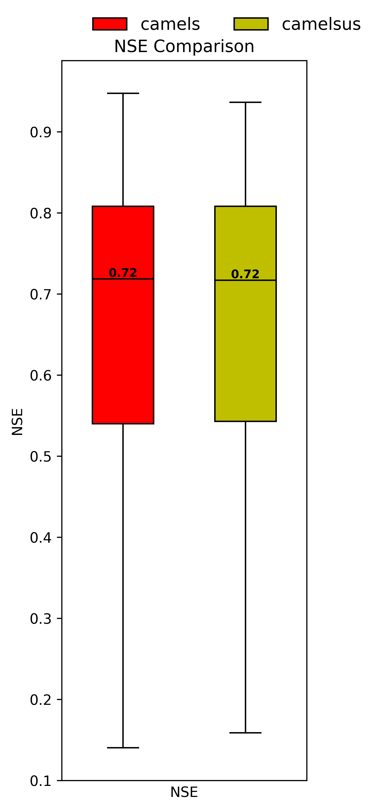

<!--
 * @Author: Wenyu Ouyang
 * @Date: 2024-04-13 18:29:19
 * @LastEditTime: 2026-08-17
 * @LastEditors: Wenyu Ouyang
 * @Description: English version of the README
 * @FilePath: \torchhydro\README.md
 * Copyright (c) 2023-2024 Wenyu Ouyang. All rights reserved.
-->
# Torchhydro

[](https://pypi.python.org/pypi/torchhydro)
[](https://anaconda.org/conda-forge/torchhydro)

- License: BSD license
- Documentation: https://OuyangWenyu.github.io/torchhydro

`torchhydro` provides datasets and models for applying deep learning to hydrological modeling. It supports Normal, Transfer Learning, Multi-Task Learning, and Federated Learning modes.

## Installation

### For Users

You can install `torchhydro` using `pip` or `uv` (which is faster).

```shell
pip install torchhydro
```
or
```shell
uv pip install torchhydro
```

### For Developers

If you want to contribute to the project, we recommend using `uv` for environment management.

```shell
# Clone the repository
git clone https://github.com/OuyangWenyu/torchhydro.git
cd torchhydro

# Create a virtual environment and install all dependencies
uv sync --all-extras
```

> **Note for local development:** the sister packages `hydrodataset`, `hydrodatasource`, and `hydroutils` are configured in `pyproject.toml` as editable local dependencies. They must be cloned into sibling directories (`../hydrodataset`, `../hydrodatasource`, `../hydroutils`) for `uv sync` to resolve them. When published to PyPI, released versions are used instead.

## Usage

### 1. Configure Data Path

Before running any examples, you need to tell `torchhydro` where your data is located.

Create a file named `hydro_setting.yml` in your user home directory (`C:\Users\YourUsername` on Windows or `~/` on Linux/macOS). Then add the following content, pointing to your data folders:

```yaml
storage:
  default_source: local
  local:
    root: 'D:/data/hydrodatasets' # Update with your root data directory
  cache: 'D:/data/hydrodatasets/cache'
```

The path to each standard dataset (e.g., CAMELS-US) is resolved automatically from this root by the unified data resolver — you do **not** need to set individual dataset paths. `storage.default_source` selects the storage backend (`local` by default, or `s3`/`cloud` for cloud storage).

### 2. Run Examples

We provide standalone scripts in the `examples/` directory to help you get started.

- **`examples/lstm_camels_example.py`**: A basic example of training a standard LSTM model on the CAMELS-US dataset.
- **`examples/dpl_xaj_example.py`**: An advanced example of training a differentiable model based on the Xinanjiang (XAJ) hydrological model.

To run an example:
```shell
python examples/lstm_camels_example.py
```

Feel free to modify these scripts to experiment with different models, datasets, and parameters.

## Data Sources

All data access goes through a **unified data resolver** (`torchhydro.configs.data_resolver`), which delegates to the hydrodataset/hydrodatasource registry. In your `source_cfgs`, use the `dataset_id` key to select a dataset; paths are resolved centrally from `hydro_setting.yml` (legacy `source_name`/`source_path` keys are still accepted for backward compatibility, but `source_path` is ignored in favor of central resolution).

Standard datasets resolved by the registry:

| `dataset_id` | Description |
|---|---|
| `camels_us` | CAMELS-US (671 US basins) |
| `camelsh` | CAMELS-Hourly |
| `caravan` / `grdc_caravan` | Caravan / GRDC-Caravan multi-dataset collections |
| `camels_aus` / `camels_br` / `camels_cl` / `camels_gb` / `camels_col` | CAMELS-Australia / Brazil / Chile / Great Britain / Colombia |

Custom data readers (provided by `hydrodatasource`): `selfmadehydrodataset`, `selfmadeforecastdataset`, `longtermdataset`, `floodeventdatasource`, `stationhydrodataset`, `tghydrodatasource`.

> GAGES-II, MOPEX, and reservoir data-source readers were moved out of `torchhydro` into `hydrodatasource`; `torchhydro` no longer re-implements them.

## Benchmark Results

We provide benchmark results on the CAMELS-US dataset to demonstrate the performance of our models. The figure below shows the NSE (Nash-Sutcliffe Efficiency) distribution comparison between two CAMELS data processing approaches:



**Figure**: NSE comparison of LSTM model trained on CAMELS-US dataset. The left box plot (red) shows results using `hydrodataset.Camels` class for data processing, while the right box plot (yellow-green) shows results using `hydrodataset.CamelsUS` class. Both approaches achieve a median NSE of 0.72, demonstrating robust and consistent performance across 671 basins.

For detailed training results, methodology, and comprehensive performance analysis, see:
- **[LSTM Training Results on CAMELS-US](docs/examples/lstm_camels_results.md)**: Complete experiment documentation including model configuration, training progress, and basin-level performance statistics.

## Explore More Features

The examples above cover two primary use cases, but `torchhydro` is much more flexible. We support a variety of models, datasets, and data sources out of the box. Explore the full public API to see all available components:

- **[Models API](docs/api/models.md)**: Discover all available model architectures.
- **[Datasets API](docs/api/datasets.md)**: See all dataset classes, data sources, and samplers.
- **[Trainers API](docs/api/trainers.md)**: Understand the core training and evaluation pipeline.

Notable capabilities include: LSTM-family and Seq2Seq/Transformer models; differentiable physical models (XAJ/HBV/GR4J); graph neural networks (GCN/GAT/STGCN/WDNE) and 3D flood-event models; MoE (mixture of experts) models; Diffusion and FNO models; cloud-Zarr lazy loading for joint training on remote data; monthly and sub-daily time units.

We are continuously working to expand the documentation with more examples.

## Main Modules

The project is organized into several key modules:

- **Trainers**: Manages the end-to-end training and evaluation pipeline. The core `DeepHydro` class handles data loading, model initialization, training loops, and evaluation. It is designed to be extensible for various learning paradigms like transfer learning or multi-task learning.
- **Models**: Contains all available model architectures, including standard neural networks (e.g., LSTM) and differentiable models. A central dictionary allows for easy configuration and selection of models and loss functions.
- **Datasets**: Provides data handling capabilities. Standard datasets are opened through the unified data resolver backed by [hydrodataset](https://github.com/OuyangWenyu/hydrodataset) and [hydrodatasource](https://github.com/iHeadWater/hydrodatasource); `torchhydro.datasets.data_sources` is a thin layer exposing the registry to datasets and PyTorch `Dataset` classes.
- **Configs**: Manages all experiment configurations, including settings for the model, data (time periods, variables), training (epochs, batch size), and evaluation. `torchhydro.configs.data_resolver` centralizes dataset path/URI resolution.

## Why Torchhydro?

While mature tools like [NeuralHydrology](https://github.com/neuralhydrology/neuralhydrology) exist, `torchhydro` was developed with a different architectural philosophy:

1.  **Decoupled Data Sources**: We believe data handling, especially for complex or private datasets, requires a separate abstraction layer. Our approach routes all standard datasets through a unified resolver (hydrodataset/hydrodatasource) that manages data access first, which then feeds into a PyTorch `Dataset`. This modularity promotes code reuse and allows the data source tools to be used even without a deep learning model.
2.  **Flexible Learning Paradigms**: The framework is explicitly designed to support not just standard supervised learning, but also more complex modes like transfer learning, multi-task learning, and federated learning from the ground up.
3.  **Deep Configuration**: We provide fine-grained control over many aspects of the pipeline, including data traversal, normalization methods, batch sampling strategies, and advanced dropout techniques, allowing for greater flexibility in experimentation.
4.  **Extensibility**: The core design principle is to externalize as much configuration as possible, enabling flexible matching and calling of different data sources and models.

## Additional Information

This package was inspired by:

- [TorchGeo](https://torchgeo.readthedocs.io/en/stable/)
- [NeuralHydrology](https://github.com/neuralhydrology/neuralhydrology)
- [hydroDL](https://github.com/mhpi/hydroDL)

This package was created using the [Cookiecutter](https://github.com/cookiecutter/cookiecutter) and the [giswqs/pypackage](https://github.com/giswqs/pypackage) project template.
